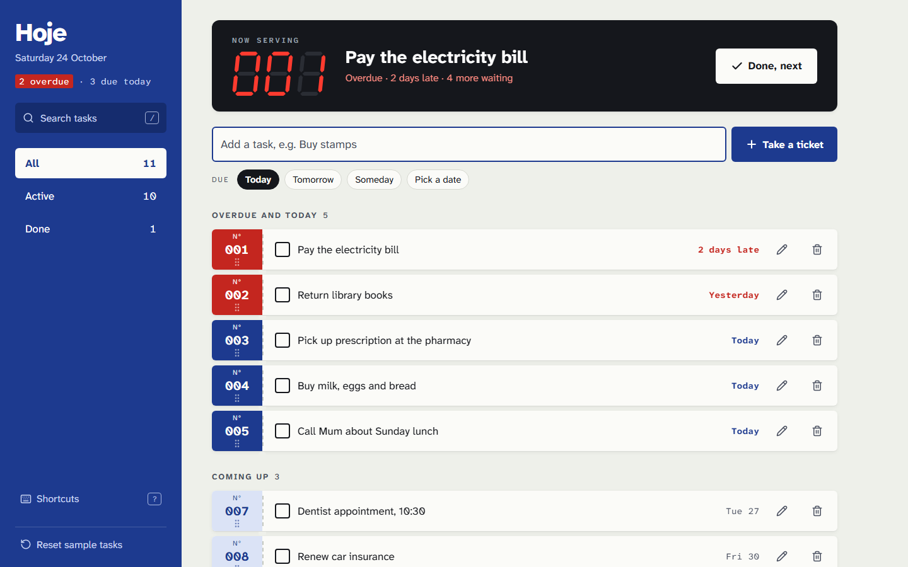
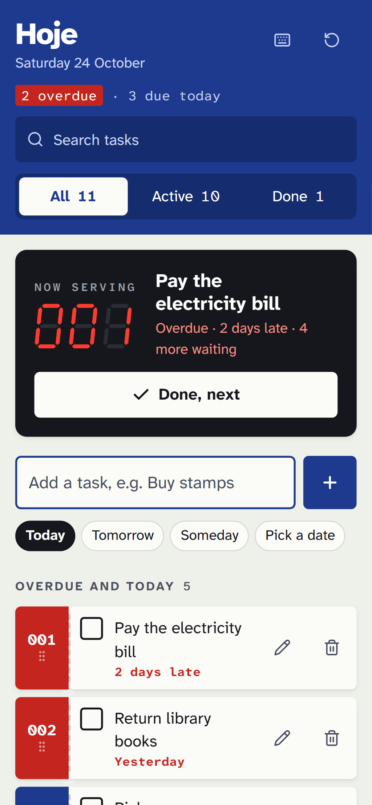
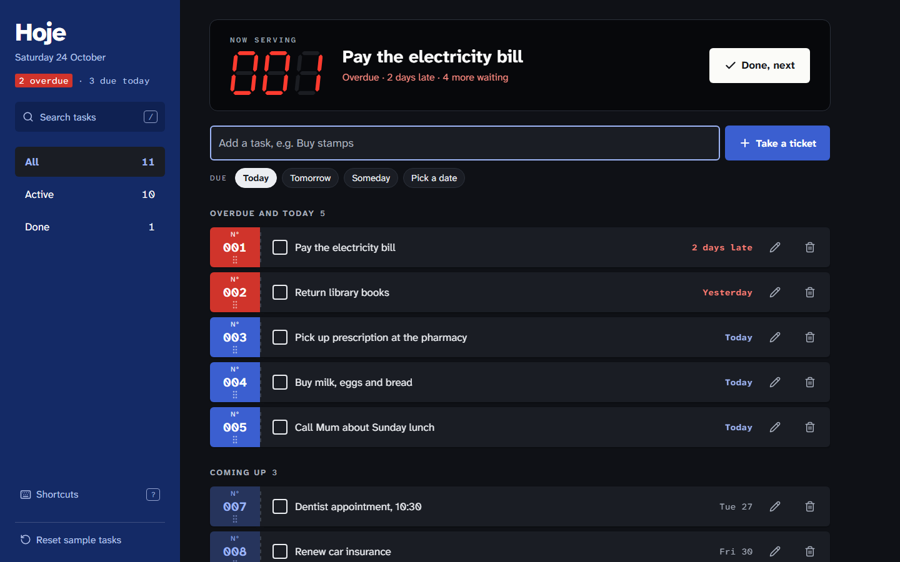

# Hoje

**A to-do list that opens on today.** Your day works like a take-a-number queue: the most urgent task is *now serving* on a red LED counter, and finishing it calls the next ticket.

*Hoje* is Portuguese for "today".

**[Live demo → kroketez.github.io/hoje-todo](https://kroketez.github.io/hoje-todo/)**



<p>
  
  
</p>

## Features

- **Today first.** Overdue and today's tasks lead. The first one is shown big on the *Now serving* counter, with a "Done, next" button.
- **Add, edit, delete.** Quick due dates (Today, Tomorrow, Someday, or pick a date). Deleting shows an **Undo** bar, and Ctrl+Z works too.
- **Mark done** with the checkbox, the counter button, or the `X` key.
- **Filters** (All / Active / Done) and **search**, which ignores case and accents.
- **Drag to reorder** by the ticket stub, with a mouse or a finger. With the keyboard, focus the stub and press ↑ / ↓.
- **Saved in your browser** (localStorage). The first visit loads sample errands, and **Reset sample tasks** brings them back (also undoable).
- **Keyboard shortcuts.** Press `?` in the app to see them all.
- **Responsive and accessible.** Phone and desktop layouts, light and dark themes, visible focus, screen-reader labels and announcements, and support for reduced motion. Checked with axe-core against WCAG 2.2 AA.

### Keyboard shortcuts

| Key | Action |
| --- | --- |
| `N` | New task |
| `/` | Search |
| `1` `2` `3` | Show all / active / done |
| `J` `K` | Next / previous ticket |
| `X` | Mark the focused ticket done |
| `E` | Edit the focused ticket |
| `Del` | Delete the focused ticket |
| `Alt` + `↑` `↓` | Move the focused ticket |
| `Ctrl` + `Z` | Undo a delete or reset |
| `Esc` | Cancel, clear search |
| `?` | Show shortcuts |

## Design

Each task is a paper ticket with a numbered stub, separated by a perforated line. The stub's colour shows urgency on one scale: red for overdue, solid blue for today, pale blue for coming up, and outline only for someday. A civic-blue rail holds the navigation. The seven-segment LED digits are drawn as SVG and used only for the one *Now serving* counter.

Type is Atkinson Hyperlegible Next and Atkinson Hyperlegible Mono, from the Braille Institute, chosen because they are built for legibility. Every size comes from one 8px grid unit.

## Tech

- [React 19](https://react.dev) + TypeScript + [Vite](https://vite.dev)
- No UI library. Drag and drop uses plain pointer events, so mouse, pen and touch all work.
- [Playwright](https://playwright.dev) tests on a desktop (1440×900) and a phone (Pixel 7) viewport, with a frozen clock and [axe-core](https://github.com/dequelabs/axe-core) accessibility checks
- GitHub Actions: lint → type-check → tests → build → deploy to GitHub Pages

## Run it locally

```bash
npm install
npm run dev
```

| Script | What it does |
| --- | --- |
| `npm run dev` | Start the dev server |
| `npm test` | Run the Playwright tests (desktop + phone) |
| `npm run lint` | Lint with oxlint |
| `npm run build` | Type-check and build to `dist/` |
| `npm run screenshots` | Regenerate the README images in `docs/` |
| `npm run ship "message"` | Lint, build, commit everything and push |

The first time you run the tests, install the browser with `npx playwright install chromium`.

## License

[MIT](LICENSE) © 2026 Simão Carvalho
